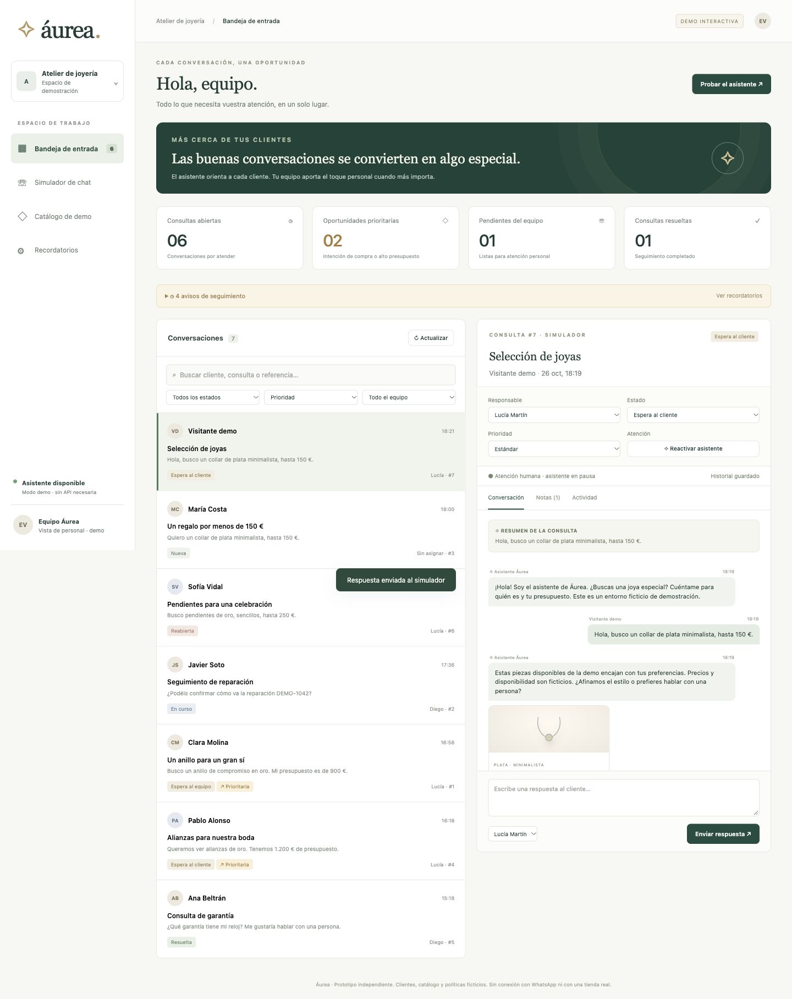
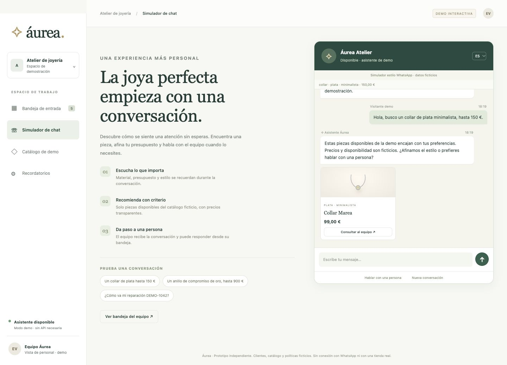
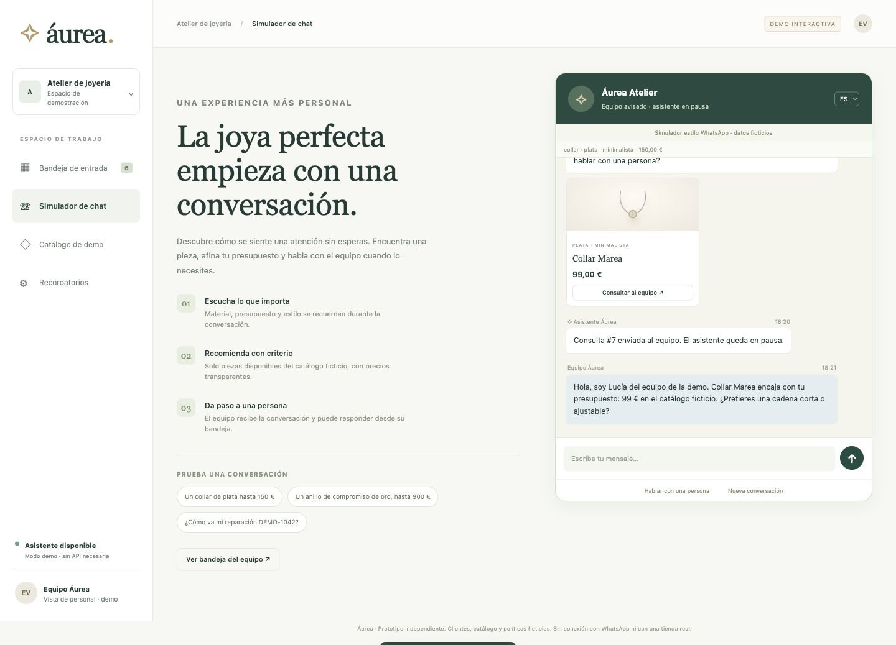
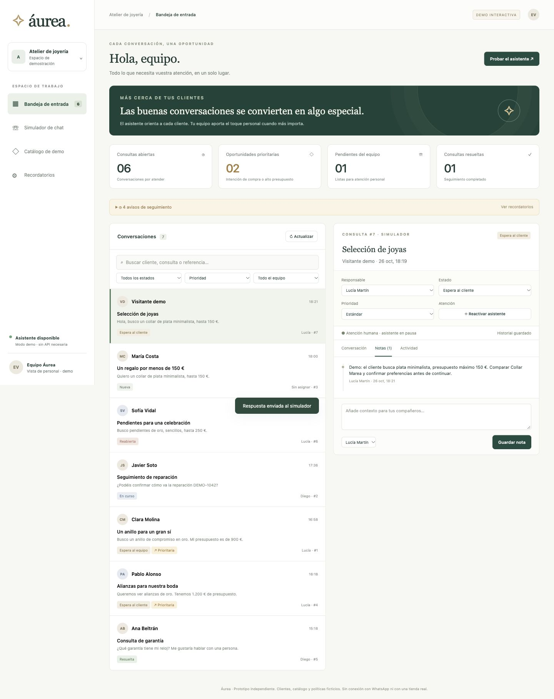
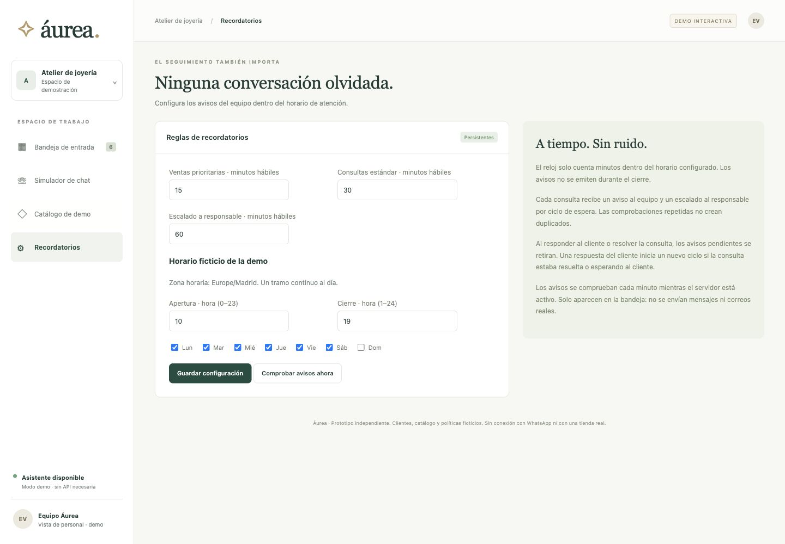

# Áurea — AI Jewelry Sales & Customer Support Assistant

A runnable, independent prototype for a small jewelry retailer. Spanish-first customer chat and staff workspace, with an English customer mode. All customers, products, availability, prices, hours and service statements are fictional. The prototype uses independent demo branding and original SVG product illustrations. It is not affiliated with or connected to a real retailer.

**FastAPI · SQLAlchemy · SQLite · Vanilla JavaScript · Optional LLM preference extraction**

Jewelry inquiries often mix product discovery with questions that need a person. Áurea demonstrates that journey in one local application: capture a customer's preferences, recommend matching catalog items, and hand the conversation to a staff inbox with persistent follow-up.

**Demo status:** runnable portfolio prototype. The default experience is deterministic and needs no API key. The optional model extracts preferences only; replies are templates grounded in the fictional catalog. There is no live WhatsApp, CRM, payment, order or inventory integration. The staff interface is Spanish; English mode covers customer messages and some chat controls, while product names and parts of the interface remain Spanish.

## Screenshots

Actual browser captures of this application using a fresh fictional database. No generated mockups, composited interfaces or real customer data.



| Customer recommendations | Human handoff and delivered staff reply |
|---|---|
|  |  |

| Ticket management and internal note | Reminder settings |
|---|---|
|  |  |

[Full screenshot gallery, capture steps and portfolio captions](docs/PORTFOLIO.md) · [Verification record](docs/VERIFICATION.md)

## Quick start

Use Python 3.12 for the reproduced setup (verified locally). The code targets Python 3.11+; other versions have not been verified in this publication pass. No Node build, paid services or API key needed.

```sh
# Run from the repository root
python3 -m venv .venv
source .venv/bin/activate
pip install -r requirements.lock.txt
python -m uvicorn app.main:create_app --factory --host 127.0.0.1 --port 8000
```

Open http://127.0.0.1:8000. API documentation: http://127.0.0.1:8000/docs.
On Windows use `.venv\Scripts\activate` instead. If your Python installation lacks IANA timezone data, install `tzdata`.

The first launch automatically creates and seeds `data/aurea.db`. Subsequent launches preserve all edits and never overwrite the seed. Stop with Ctrl+C and rerun the same command. To use a separate demo database, set `DATABASE_URL=sqlite:////absolute/path/demo.db` before launch. SQLite is the only supported database in this MVP. Back up the database while the server is stopped (or use SQLite's backup API).

`requirements.lock.txt` captures the tested exact versions. `requirements.txt` lists the supported top-level dependency ranges. No frontend CDN or external image requests are needed.

## Three-minute demonstration

1. Open **Simulador de chat** and start a **Nueva conversación**.
2. Ask `Un collar de plata hasta 150 €`. The assistant shows the available Collar Marea at €99, directly from the fictional catalog. Try a follow-up such as `minimalista` or `hasta 80 €`.
3. Click **Hablar con una persona**, then **Ver bandeja del equipo**. The ticket is selected automatically.
4. Assign an employee, set **En curso**, add a private note in **Notas**, and send a reply from **Conversación**. The status becomes **Espera al cliente** and reminders pause.
5. Return to the simulator: staff replies appear within three seconds. Send a follow-up; the ticket becomes **En curso**. Resolve it in the dashboard, then send another customer message to demonstrate **Reabierta**.
6. Explore **Catálogo de demo** and **Recordatorios**. Expand the reminder strip in the inbox to see pending notices. The **Actualizar** button fetches new tickets and notices without a page reload.

Changing ES/EN starts a new conversation; earlier conversations remain in the database. The browser remembers the most recent customer conversation. All seeded examples remain available in the staff inbox.

## Features

- WhatsApp-inspired simulator, 24 fictional products, original SVG illustrations, no real messaging.
- Deterministic Spanish/English preference parsing for category, budget, material and style, with multi-turn memory. `sin filtros` / `clear filters` clears preferences. `sin presupuesto` removes the budget.
- Availability, category, material, style and maximum budget are hard filters. Matching products rank closest to the budget, or by ascending price when no budget is provided. No matching products yields an honest empty result; constraints are never silently relaxed.
- Sales inquiries create tickets. Budget ≥ €500, explicit buying intent, engagement requests or urgency mark a high-priority lead.
- Unverified policies, order/repair status requests and human assistance requests create or reuse a ticket and pause the assistant. The application never claims to know a real order status, reservation, delivery promise or policy. Staff replies are manually authored.
- One ticket per conversation; customer history, preferences and deterministic summaries, assignment, priorities, six lifecycle states, private notes, human takeover/resume, staff replies, search, filters and activity history.
- SQLite persistence for every dashboard mutation and reminder. Customer endpoints exclude notes and activity.
- Hour-aware in-dashboard reminders with configurable thresholds and owner escalation.

## Architecture

```text
Browser — static HTML / CSS / ES modules (no build step)
    │ JSON REST over same origin
FastAPI (app/main.py)
    ├── assistant.py  — channel-independent intent / handoff orchestration
    ├── catalog.py    — preference parsing and database-backed recommendations
    ├── tickets.py    — explicit transition rules and audit events
    ├── reminders.py  — business-time arithmetic and idempotent reminder sweep
    ├── seed.py       — catalog + six realistic fictional customer examples
    └── db.py         — SQLAlchemy entities and SQLite setup
```

The frontend intentionally uses native browser modules instead of a framework: four views, one server, no bundler or runtime frontend dependency. SVG product illustrations are generated locally from the category and material. Monetary values are stored as integer cents. Timestamps are UTC in SQLite and serialized with `Z`; business-hour calculations use `Europe/Madrid` via `zoneinfo`.

`create_app()` is an application factory for isolated tests and alternate databases. SQLAlchemy sessions are request-scoped; writes commit transactionally. Foreign keys and WAL mode are enabled. The server runs a reminder sweep on startup and every 60 seconds. Use **one Uvicorn worker** for this local MVP; a database uniqueness constraint additionally protects against duplicate reminder rows.

### Schema

See `schema.sql` for the complete SQLite DDL; `app/db.py` is the authoritative model definition.

| Table | Purpose / relationships |
|---|---|
| products | Name, category, integer price cents, material, style, description, availability |
| customers | Fictional customer identity |
| conversations | Customer FK, channel, language, persisted preferences, takeover flag |
| messages | Conversation FK, sender role, body, recommended product IDs, timestamp |
| employees | Staff identity and role; one seeded owner |
| tickets | Unique conversation FK, summary, priority, status, employee FK, reminder clock/cycle |
| notes | Ticket + employee FKs, internal text |
| activity_events | Ticket FK, audit event and timestamp |
| reminders | Ticket FK, cycle, staff/owner kind, recipient, acknowledgement; unique ticket/cycle/kind |
| settings | Persistent thresholds, business hours, weekdays and timezone |

No schema migration tool is included. Schema evolution should use Alembic before retaining databases across future model changes. Recommended product IDs are JSON references for the read-only MVP catalog; there is no product deletion endpoint.

### Ticket lifecycle

- New → Waiting for Staff / In Progress / Waiting for Customer / Resolved
- Waiting for Staff → In Progress / Waiting for Customer / Resolved
- In Progress → Waiting for Staff / Waiting for Customer / Resolved
- Waiting for Customer → In Progress / Waiting for Staff / Resolved
- Resolved → Reopened
- Reopened → Waiting for Staff / In Progress / Waiting for Customer / Resolved

Invalid transitions return HTTP 409. A staff reply moves an open ticket to Waiting for Customer and enables human takeover. A customer message reactivates a waiting ticket or reopens a resolved ticket. Resolving a conversation does not silently reactivate the bot; staff can explicitly resume it.

### Reminder semantics

Default hours: Monday–Saturday 10:00–19:00 Europe/Madrid (fictional). High-priority threshold: 15 business minutes; standard: 30; owner: 60. One continuous daily interval; no holiday calendar or lunch break in this MVP.

The clock starts when a ticket is created, resumes as a fresh cycle when it leaves Waiting for Customer or Resolved, and continues while New, Waiting for Staff, In Progress or Reopened. Assignment and internal notes do not reset the clock. New incoming messages while already waiting for staff do not postpone the deadline. Staff replies or resolution acknowledge all outstanding reminders and stop the clock.

Only in-hours sweeps emit notices. Each cycle produces at most one staff notice and one owner notice, even across restarts. Acknowledging a notice does not resend it or suppress a later owner escalation. A settings change applies to existing active clocks at the next sweep; it does not reissue notices already sent in that cycle. When the server was stopped, the next in-hours startup sweep catches up. Notices appear in the dashboard on load or **Actualizar**; **Comprobar avisos ahora** runs a manual sweep.

### Optional LLM integration

Fully optional. With no variables configured, no model requests are made. Configure a provider supporting the OpenAI-compatible Chat Completions JSON format:

```sh
export LLM_BASE_URL="https://your-provider.example/v1"
export LLM_MODEL="your-model-id"
export LLM_API_KEY="your-key"
```

The server sends only the current customer message to that provider. Keys stay server-side. The LLM can extract only allowlisted category/material/style preferences. Budget parsing remains deterministic; prices, availability, product cards and all assistant wording always come from code/database templates. The model cannot execute tools, change tickets, compose policies, or provide order status. Invalid responses, timeouts and network failures fall back to the deterministic parser. The integration is tested with mocked success/failure; no paid/live model was used in verification.

## API overview

Interactive OpenAPI documentation is served at `/docs` while the app is running.

| Method | Path | Purpose |
|---|---|---|
| GET | `/api/health`, `/api/products` | Health check and fictional catalog |
| POST | `/api/conversations` | Create a Spanish or English customer conversation |
| GET | `/api/conversations/{id}` | Read customer-visible history and recommendations |
| POST | `/api/conversations/{id}/messages` | Send a customer message |
| POST | `/api/conversations/{id}/ticket` | Request human assistance |
| GET | `/api/dashboard` | Ticket metrics, filters, employees and pending notices |
| GET / PATCH | `/api/tickets/{id}` | Read or update ticket state, assignment, priority or takeover |
| POST | `/api/tickets/{id}/notes`, `/api/tickets/{id}/reply` | Internal note or customer-visible staff reply |
| GET / PUT | `/api/settings` | Read or change reminder configuration |
| POST | `/api/reminders/run` | Run a reminder sweep |
| POST | `/api/reminders/{id}/acknowledge` | Acknowledge a reminder |

These routes have no authentication and are intended for localhost only.

## Troubleshooting

- **Port already in use:** choose another port, e.g. `PORT=8017 ./run.sh` on macOS/Linux.
- **Missing dependencies:** activate the virtual environment and reinstall `requirements.lock.txt` with Python 3.12.
- **No reminders:** notices are generated only within the configured business hours; check the timezone and active ticket state. Open the inbox and use **Actualizar** to retrieve notices.
- **Chat language:** switching ES/EN creates a new conversation. Product data remains in Spanish.
- **Environment file has no effect:** `.env.example` documents variables; there is no automatic `.env` loader. Export the variables before starting the server.
- **Fresh demo:** stop the server and point `DATABASE_URL` to a new SQLite file. Keep your existing database as a backup.

## Tests

```sh
source .venv/bin/activate
python -m pytest -q
```

Tests use temporary SQLite databases, isolated from the demo data. Coverage includes hard recommendation constraints and ranking, Spanish budget parsing, multi-turn preferences, empty/unavailable matches, grounded responses, unknown-policy/order escalation, optional model validation/fallback, human takeover, complete ticket lifecycle, staff notes, searching, invalid transitions, restart persistence, English chat, reminder thresholds, duplicate suppression, owner routing, pause/restart cycles, closed hours, weekends, the October daylight-saving boundary, and settings validation.

Manual browser verification: recommendation → human request → staff reply → delivered customer response. Dashboard and chat layouts were visually inspected. A benign upstream Starlette warning about its future HTTP test transport may appear; the tested HTTPX transport currently works.

## Scope and production boundary

This is a **localhost, single-store demonstration**, not an internet-facing service. It has no authentication, role enforcement or tenant isolation; anyone who can reach it can use staff endpoints. Internal notes are separate from customer API responses, but that is not access control. Do not enter real customer data or expose the port publicly.

Before a production pilot: add staff authentication and role checks, customer session authorization, tenant scoping, retention/consent controls, rate limits, migrations, backups, error monitoring and adapter-level webhook verification/idempotency. The synchronous optional model call holds the chat transaction briefly; use queued processing for production. Simultaneous staff edits use last-write-wins. Rule-based parsing is deliberately limited; complex alternatives and negated preferences may need staff clarification. There is no reservation, checkout, real inventory, repair lookup, WhatsApp connection, email delivery, or embedded website widget.

For future channels, wrap incoming platform messages in the conversation/message service and adapt outbound replies/cards. Keep recommendation and ticket/reminder rules independent of the channel; add external message IDs and idempotent ingestion before connecting real WhatsApp or website chat.

## Repository layout

```text
app/                     FastAPI application, domain logic and static frontend
  static/                HTML, CSS and JavaScript; original inline SVG illustrations
tests/                   Recommendation, ticket and reminder tests
schema.sql               Reference SQLite schema
requirements.lock.txt    Exact dependencies from the tested local environment
requirements.txt         Top-level dependency ranges
.env.example             Placeholder configuration; not loaded automatically
run.sh                   Localhost launcher for an existing .venv
scripts/                 Tracked-file publication audit
.github/workflows/       Test workflow configuration
docs/                   Portfolio gallery and verification evidence
```

Local databases, virtual environments, caches and secrets are excluded from version control. The publication starts with a new Git history and includes only this application, its documentation and fresh demo screenshots.

## License

Licensed under the [MIT License](LICENSE). Dependencies retain their respective licenses.
