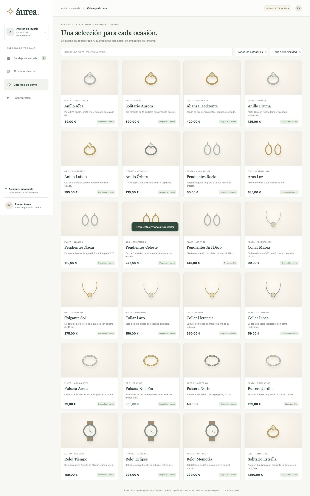

# Portfolio gallery

Captured on 26 October 2026 from the running local application at a 1440px desktop breakpoint. JPEGs are direct full-page browser captures; heights vary with content. Names, prices, products, conversations and notes are fictional. Screenshots show the default deterministic mode with external model configuration disabled. Browser mobile layout was also inspected at the initial 320px viewport.

## Suggested LinkedIn order and captions

1. **Customer recommendations** — A silver, minimalist necklace request under €150 returns Collar Marea at €99 from the fictional SQLite catalog. Category, material, style, availability and budget are hard constraints.
   
2. **Staff dashboard** — A persistent inbox combines open-query metrics, assignment, priority, conversation history and customer replies.
   
3. **Ticket management** — Staff assign an inquiry, move it to In Progress and record an internal note. Customer-facing responses omit notes; this is not authentication.
   
4. **Customer chat and handoff** — Requesting a person pauses the assistant. The staff reply is delivered back into the simulator.
   
5. **Catalog** — 24 fictional products with locally generated SVG illustrations and search/category/availability filters.
   
6. **Reminder configuration** — Business-hour thresholds and working days persist in SQLite; notifications stay inside the dashboard.
   

## Reproduce the main screenshots

Start with a new SQLite file using `DATABASE_URL`, and leave the optional LLM variables unset. Open the chat simulator and send `Hola, busco un collar de plata minimalista, hasta 150 €.`. Capture the returned Collar Marea card. Click **Hablar con una persona**, then **Ver bandeja del equipo**. Assign Lucía Martín, choose **En curso**, and save a fictional note under **Notas**. Capture the ticket, then send a reply from **Conversación**. Capture the inbox and return to the simulator to capture delivery. The repository does not ship the capture database; ticket numbers, timestamps and reminder counts vary by run.

## Suggested LinkedIn project description

Built Áurea, a local jewelry sales and customer-support prototype using FastAPI, SQLAlchemy, SQLite and vanilla JavaScript. It combines catalog-constrained recommendations with human handoff, staff ticket management, internal notes and business-hour reminders. The default assistant uses deterministic rules and templates, with optional LLM preference extraction. All portfolio examples use fictional data; this is a demo without live WhatsApp or CRM integration.

Do not describe this as a deployed retail product, an authorized retailer integration, a live WhatsApp bot, a fully generative agent or a measured business outcome. No real sales, conversion or response-time metrics have been collected.
